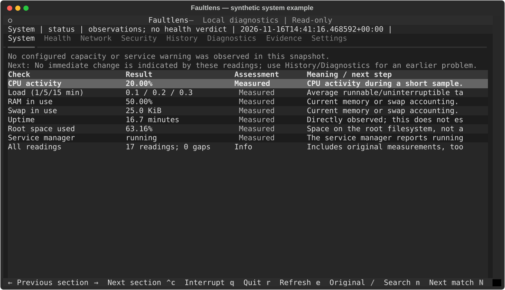

# Faultlens — Linux system monitoring and diagnostics

Faultlens is a local Linux administration tool for system monitoring, troubleshooting
and evidence-backed incident analysis. Its CLI and keyboard-driven TUI explain current
measurements, retained journal events, Atop recordings and security indicators, with
original evidence available for inspection.

**Pre-release:** source checkout only; no supported production release or packaged
installer yet. Target: Debian/Ubuntu Server with Python 3.11+.

[](https://github.com/mfuryto/faultlens/actions/workflows/security-baseline.yml)
[](https://github.com/mfuryto/faultlens/actions/workflows/codeql.yml)

[Quickstart](#quickstart) · [CLI examples](#cli-examples) · [Documentation](#documentation) ·
[Contributing](CONTRIBUTING.md) · [GPL-3.0-or-later](LICENSE)



## Why Faultlens?

- **Local and read-only diagnostics.** No telemetry, cloud services, remote probes,
  database or Faultlens daemon. Existing permissions determine which sources are visible.
- **Understandable results.** Readings and findings explain what was observed, what it
  can mean, confidence, limitations and follow-up. Technical details remain accessible.
- **Administrator evidence.** Original names, addresses, ports, logs and collected
  crash fragments remain visible without privacy masking. Terminal controls are escaped.
- **Bounded collection.** Fixed command arguments, output/time limits and cancellation
  reduce overhead while investigating an already troubled server.
- **A useful terminal workspace.** Source tabs load when opened, details open in dialogs,
  and per-user preferences survive restarts. The CLI remains independent of TUI packages.

## Features

| Area | What you can inspect |
| --- | --- |
| System monitoring | CPU activity and load, RAM/swap, root filesystem capacity, device/interface counters, visible process count and selected service state |
| Recording readiness | Optional tool availability, journal/Atop services, retention configuration and recording inventory |
| Boot and incident history | Accessible boot IDs, multi-boot summaries, bounded journal tails, targeted kernel/systemd searches and chronology |
| Historical performance | Existing Atop CPU, memory, swap and optional disk/network/process recordings, with explicit replay and coverage limits |
| Network and security | Current TCP/UDP pressure counters and local sockets; selected-boot SSH/firewall reports and Possible historical indicators |
| Crash evidence | Supported live pstore and systemd-pstore archive fragments, original content and panic-signature observations |
| CLI and TUI | Readable explanations, technical details, JSON output, keyboard navigation and saved collection preferences |

Security's live network overview and selected-boot SSH/firewall diagnostics are separate
sources. No matched indicator is an **Unknown assessment**, not an all-clear.
See [what Faultlens solves and still lacks](docs/stabilization.md).

## Quickstart

Use a trusted checkout as its ordinary, non-root owner. Linux and Python 3.11+ are
required. The optional terminal workspace installs from an exact wheel-hash lock:

```bash
git clone https://github.com/mfuryto/faultlens.git
cd faultlens
python3 -m venv .venv
.venv/bin/python -m pip install --require-hashes --only-binary=:all: -r requirements-tui.txt
.venv/bin/python bin/faultlens tui
```

If Python's `venv` module is unavailable, use your distribution's virtual-environment
package. Faultlens never installs packages or enables services at launch.

For CLI-only use, no external Python packages are required:

```bash
./bin/faultlens status
./bin/faultlens --help
```

### Terminal navigation

| Key | Action |
| --- | --- |
| Left / Right | Change section; source data loads automatically |
| Up / Down | Select a row |
| Enter / Esc | Open details / return |
| r | Refresh or retry collection |
| e | Inspect original retained evidence |
| ? / q | Help / quit |

Preferences save on valid changes to `~/.config/faultlens/settings.json`, or under
`XDG_CONFIG_HOME` when configured. Accounts have separate preferences. Diagnostic
reports and logs are not saved automatically. See [workspace setup and controls](docs/tui.md).

## CLI examples

```bash
# Current resources, optional tools and recording readiness
./bin/faultlens status
./bin/faultlens check --history

# Current network counters and local numeric socket endpoints
./bin/faultlens network --sockets
./bin/faultlens security --sockets

# Accessible boot history and a selected-boot journal investigation
./bin/faultlens history
./bin/faultlens diagnose --boot 0 --search-events --search-ssh --search-firewall

# Existing historical recordings and crash evidence
./bin/faultlens diagnose --previous-boot --atop-date YYYYMMDD --atop-extended
./bin/faultlens diagnose --previous-boot --pstore --pstore-archive

# Machine-readable report or additional technical details
./bin/faultlens status --json
./bin/faultlens status --details
```

Replace `YYYYMMDD` with an existing recording date; installing Atop cannot recreate
past measurements. Add `--system-journal` to explicitly select accessible system
journals. This flag grants no access: an ordinary user's visible logs may contain
personal evidence only. Faultlens never elevates itself.

Journal features need `journalctl`; socket snapshots use `ss`; historical replay uses
an existing Atop installation and recordings. Missing tools or access make the affected
source unavailable. You do not need to install every optional utility.
See [feature dependencies](docs/dependencies.md) and the [full CLI reference](docs/cli-reference.md).

## Evidence and limitations

- A confirmed recorded event is not a confirmed cause. Missing logs, zero findings
  or an empty crash archive cannot rule out a freeze, crash or attack.
- Journal analysis and searches are bounded; the ordinary tail retains at most 500
  records. Coverage and selected boot/source identity matter.
- Atop host/boot identity remains unverified. The current 30-minute replay window can
  be too short for the six-sample historical comparison with ten-minute recordings.
- Current counters and socket bindings do not establish external reachability,
  effective firewall policy or a comprehensive intrusion assessment.
- Real target-server/SSH acceptance and detector calibration remain open. Synthetic
  tests exercise known behavior; passing tests do not prove a healthy server.

Review source scope and originals before acting. Output may contain sensitive
administrator evidence; review it before manually sharing or redirecting it.

## Test your server

After installing the optional workspace requirements, run as the checkout owner:

```bash
.venv/bin/python scripts/server_check.py
```

The summary separates what worked, what could not be verified and any follow-up.
Use `--details` for individual checks or `--json` for structured output. The script
is read-only and does not configure your server. See [server testing](docs/server-check.md).

## Documentation

| Start here | Reference |
| --- | --- |
| Setup, keys and saved preferences | [Terminal workspace](docs/tui.md) |
| Commands, exit codes and collection bounds | [CLI reference](docs/cli-reference.md) |
| Meaning, confidence and next steps | [Reading results](docs/readable-results.md) |
| Tools and optional integrations | [Dependencies](docs/dependencies.md) |
| Known gaps and development priorities | [Stabilization plan](docs/stabilization.md) |
| Architecture, source trust and security boundaries | [Threat model](docs/security/architecture.md) |
| Reproducible measurements and resource tests | [Benchmarks](docs/benchmarks.md) |
| Deployment and release gates | [Release readiness](docs/release-readiness.md) |
| Detailed design and acceptance history | [Product specification](docs/product-specification.md) |

## Development and contributions

Develop on `staging`; reviewed changes reach `main` only after required security checks
pass. Keep Git and development tests under the checkout owner. Tests use synthetic
evidence and do not require access to real system logs.

```bash
.venv/bin/python -m unittest discover -s tests -q
.venv/bin/python scripts/security_check.py
.venv/bin/python scripts/benchmark.py --iterations 10
.venv/bin/python scripts/vps_acceptance.py --iterations 3
```

Read [CONTRIBUTING.md](CONTRIBUTING.md) before contributing. Never commit real logs,
credentials, local preferences or diagnostic reports. Report suspected vulnerabilities
privately using [SECURITY.md](SECURITY.md), rather than a public issue containing evidence.

## License

Copyright (C) 2026 mfuryto and Faultlens contributors.

Faultlens is free software under the **GNU General Public License, version 3 or any
later version** (`GPL-3.0-or-later`). You may redistribute and modify it under those
terms. It comes **without warranty**, including implied merchantability or fitness
for a particular purpose. See [LICENSE](LICENSE) for the full terms and [NOTICE](NOTICE)
for the project grant. [Third-party dependencies](docs/third-party.md) retain their
respective licenses.
