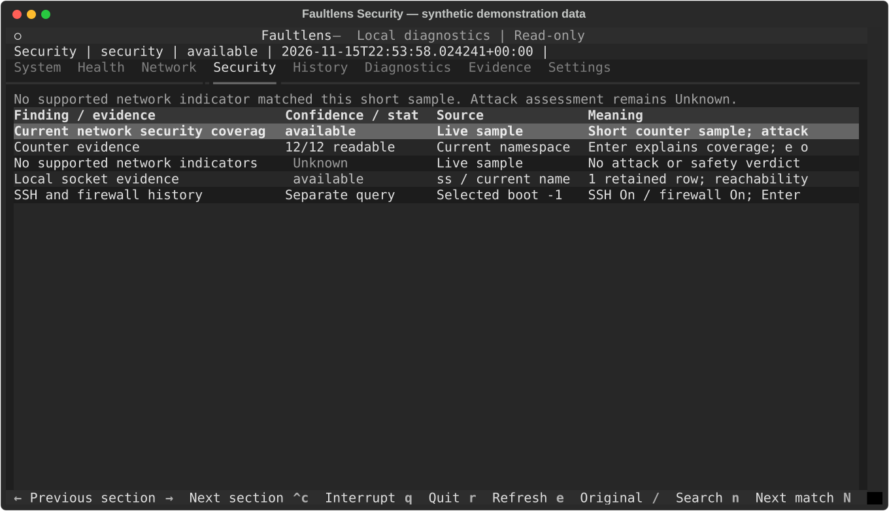

# UserDock-style terminal workspace

Faultlens uses the same interaction structure as the locally reviewed UserDock
reference: Textual Header, status line, horizontal TabbedContent, row-cursor
DataTables, modal screens and Footer. The old curses renderer is removed. The
primary workspace is domain tables, not a JSON/object menu. CLI collectors and
structured output remain independent of Textual.

## Install and launch

Use a trusted checkout as its owner:

```sh
python3 -m venv .venv
.venv/bin/python -m pip install --require-hashes --only-binary=:all: -r requirements-tui.txt
.venv/bin/python bin/faultlens
```

Running `faultlens` without arguments selects the workspace; `faultlens tui` remains
a compatible explicit alias. In the source checkout, use the virtual-environment
Python shown above, or activate `.venv` before running `./bin/faultlens`. A noninteractive
invocation without arguments reports that a terminal is required; it never silently
switches to a CLI snapshot. Use `faultlens status --json` for scripts. Explicit CLI
commands (including the existing `faultlens --json` status shorthand) work with system
Python without these optional packages. No dependency downloads or installation occur at launch.
The reviewed Textual version and complete pure-Python wheel closure are pinned in
requirements-tui.txt; do not mix UserDock's environment with this project's.

Faultlens does not need root to launch. Source access depends on existing account
permissions. No elevation, account/group changes or host configuration writes occur.

## Navigation

| Key | Action |
| --- | --- |
| Left / Right | Previous / next main section, wrapping at either end |
| Up / Down, PageUp / PageDown, Home / End | Move through table rows |
| Enter | Open the selected record, finding, source or setting |
| Esc | Close the current dialog; at the workspace, cancel active collection |
| e | Open unchanged original evidence for the selected row/source |
| s | Explain the current snapshot or source coverage |
| r | Explicitly collect the current source section |
| /, n, N | Literal table search; next / previous match without filtering rows |
| Ctrl-Left / Ctrl-Right | Previous / next batch in a source-record dialog |
| q | Quit; in the raw evidence browser, close that browser |
| Ctrl-C | Cancel collection and quit with 130, restoring the terminal |
| ? | Keyboard, collection and confidence help |

Within an input dialog, arrow keys edit the input instead of switching sections.
Enter applies validated session options; Esc cancels. Boolean collection options
toggle through their table row. Changes affect later collection only.

System status loads on startup. Each source section loads when first opened,
then reuses its snapshot on later visits. Changed collection options are applied
when the source section is reopened; r always requests a fresh read. Evidence and
Settings do not collect. Only one read runs at once; switching during a read loads
the currently selected source section after it finishes, without querying intermediate
tabs. Failed or cancelled reads do not retry in a loop; r retries. Read-only coverage defaults on; the scope exceptions below remain explicit. Collection runs in a bounded,
cancellable child process so tabs and cancellation remain responsive. A cancelled
refresh retains no replacement report. Native readers retain their own access and
resource constraints; kernel-uninterruptible I/O remains an operating-system limit.

## Sections and evidence

| Section | Main table / action |
| --- | --- |
| System | Prioritized resource/service readings, reported logged-in users, a next step and grouped access to all measurements |
| Health | Operational readings and observed failed services, separate from journal/recording readiness and tool/default details |
| Network | Error/gap/activity-prioritized interface examples, protocol review counts and optional sockets; all interfaces remain in a paged table |
| Signals | Current network indicators, source coverage and sockets, including zero-match states; a separate link opens selected-boot SSH/firewall history |
| History | Retained UTC ranges and named report examples; Investigate this boot pins its ID and opens Diagnostics |
| Investigate | Problems now, a selected period or before-restart context; investigation answer, actual message excerpts, timestamps and follow-up; all grouped reports and sources remain accessible |
| Evidence | Explicit access to complete original report/source trees |
| Settings | Typed per-user preferences, saved on valid changes; no server configuration editor |

Repeated reports are grouped in the overview rather than called separate incidents.
Source dialogs render at most 64 rows per batch, show the retained total and retain
all records; Next/Previous or Ctrl-Right/Left reach the other batches. Pagination is
a rendering bound, not source truncation or redaction. Details explain observation,
meaning, confidence and next steps. Original and Records open retained evidence.
Raw trees are secondary inspection tools, never the main navigation model.

The workspace retains at most one bounded snapshot per six source sections. Replacing
a section drops its prior report first; Evidence shares source references. Security
uses its own current report and never falls back to a cached diagnosis. Timestamps, actual report command and changed-option
notices distinguish stale or differently scoped results. No diagnostic snapshots or evidence are persisted.

## Safety and acceptance

Source strings are literal Rich Text with reversible ASCII/JSON escaping, never
markup, links, shell syntax or terminal sequences. Names, IPs, ports, original logs,
process identities and crash content are retained without privacy masking. Base64
represents original bytes; browsing does not decode them to files. Textual developer
endpoints, alternate drivers and log destinations are disabled. Fatal UI errors do
not render source exception text or locals.

Tests drive the real Textual app through Pilot, plus a real PTY for normal quit,
Ctrl-C and terminal restoration. Layout/navigation are checked at 100x30, 80x24 and
40x10, including resize and input focus. Synthetic screenshot previews contain no
host evidence. Actual server/SSH-client acceptance remains necessary; see
[server checks](server-check.md), [stabilization and product fit](stabilization.md)
and [frontend acceptance](architecture/phase-4-acceptance.md).

## Synthetic interface previews

These captures render the actual frontend using invented test data, never host logs.


Timeline details also retain a separate original position (`p` / Position), so the
finding and its timeline reference can both be inspected without guessing identity.

## Defaults and lifetime

Saved preferences are loaded at launch. Without a valid saved file, Faultlens
uses the administrator defaults: Problems now with no boot filter, current boot in the overview, recording/retention
checks, socket endpoints, broader kernel/service searches, SSH/firewall searches, and
live/archived crash-evidence reads are On. These read existing accessible sources;
they do not enable logging, configure recorders, grant access or create reports.
Missing sources remain unavailable evidence, never a reason to install or elevate.

"Use accessible system journals" remains Off: this selects system-only scope rather
than enabling journal collection. Accessible journal evidence is already read; forcing
system-only scope can hide usable personal records when system access is unavailable.
Enable it when system-only evidence is intended and existing access permits it.

Atop date remains unset, and extended replay stays Off until an existing date is
selected. No recording/boot association is guessed. Date boundaries remain unset
unless the operator wants to narrow the journal search. These choices preserve source
scope; they are not disabled general monitoring.

## Saving preferences

The normal TUI entrypoint loads `${XDG_CONFIG_HOME}/faultlens/settings.json`, or
`~/.config/faultlens/settings.json` when XDG_CONFIG_HOME is unset, empty or relative.
Valid edits and boot selection save immediately. There is no need to quit normally
to save; invalid edits leave the previous file intact. Merely launching the TUI does
not create a file. CLI observations and server configuration are unchanged.

Only the fixed collection settings are stored: booleans, sample duration, overview
count, selected boot, Atop date and optional journal boundaries. No reports, snapshots,
search text, paths to arbitrary evidence, logs or credentials are saved. Boot IDs,
dates and boundaries retain their literal selection across restarts; clear or change
them when investigating another period. Relative boot indices remain relative.

Each Unix account has its own preferences. Root does not load another user's file.
Configuration directories/files must belong to the current effective user, with no
shared writes to the base directory and private app-directory/file permissions.
New app directories use 0700 and files 0600. Symlink components, non-regular files,
hardlinks, wrong owners, unsafe permissions, unknown schema/fields, invalid types or
ranges and files above 8 KiB are rejected. All fields validate before any are used.
Writes use a private temporary file, flush/fsync and atomic replacement; existing
unsafe files are never chmodded or followed.

Settings shows the path and load/save status. If a file is invalid, defaults are used
with a notice. If saving fails, the current session remains usable and explicitly
reports that persistence was not confirmed. Concurrent instances use the last
successful save. To reset defaults, remove the preference file while Faultlens is
closed. Schema 1 preferences migrate explicitly to schema 2, retaining the old boot filter and time values with a notice. A legacy one-sided time range retains its technical single-boot behavior until a new entry is chosen. No diagnostic export is performed.

A supplied initial TUI sample duration seeds first-launch defaults; a saved preference
takes precedence. Use Settings to update that duration for later launches.

## Security coverage and empty results

Security checks a short current-network-namespace counter sample and requested local
sockets. With no matched indicators, it still shows readable counter coverage, socket
source state and the Unknown attack assessment. Available/partial/unavailable describes
source collection, not a safe/compromised verdict. Original readings remain accessible.

The SSH and firewall history row opens Diagnostics using the existing selected boot,
journal scope and search toggles. The row shows whether each search is On/Off. It does
not change preferences, query another boot or reuse historical findings as live network
observations. Disabled searches and missing journal access remain separate limitations.

Loading, cancellation and unsuccessful collection have their own visible rows even
when no snapshot exists. Esc cancels; r retries after cancellation/failure. Collection
starts after the first screen layout so immediate navigation is not reset by tab setup.
Empty source tables describe this view only: unclassified original records may still
exist; s explains source coverage and e opens originals.



## Current-server decision views

System, Health and Network use the same interpretation model as their readable CLI
commands. Each starts with a short answer and next step, followed by Check, Result,
Assessment and Meaning/next step. Open a row for full context; compact terminals may
show fewer columns, but values and assessments remain visible. Source-detail tables
keep their value/status columns within the viewport, including after resizing.

- Critical/Review identifies an observed capacity limit or a specific review hint.
  A short CPU sample >=90% gets a disclosed review hint, not a sustained-overload or
  per-process diagnosis. Existing memory/filesystem thresholds remain unchanged.
- Measured means a value or comparison was collected; it is not a whole-server verdict.
- Gap/Partial means a required comparison/source was not established. A reset or an
  inaccessible source never becomes zero activity.
- Info includes optional tools, configuration hints and unverified defaults. No empty
  value or automatic configuration change is used to resolve those uncertainties.
- Active/Idle describes observed interface counters during this sample only. Roles,
  routes and physical/virtual identity are not guessed from interface names.

Health now runs `health --json` instead of the readiness-only `check` operation. It
combines a current resource/manager snapshot with readiness observations and a bounded
system-manager failed-service query. Enter Failed services for unit names, descriptions
and original rows. Failure state is not verified impact or cause. Previous-boot listing,
active recorders and date-named files are separate readiness hints, not verified system
journal coverage or complete replay. Deeper recording checks still follow the existing
preservation preference; the settings schema is unchanged.

Network shows at most three relevant interface examples; comparison gaps and observed
error/drop growth take priority over activity. All interfaces contains every retained
row, including idle entries. RX is received traffic, TX is sent traffic, in bytes per
second with IEC units. Overlapping virtual/physical layers are never added into a host
throughput total. Requested CLI socket output retains all endpoint rows; TUI sockets
remain available in their own domain table. `--details`/`--json` retain full source data.

See [milestone 1 design and acceptance](architecture/milestone-1-current-overview.md).

## Find what went wrong

Open **Investigate** directly, or use **Investigate a problem now** from System,
Health or Network. Three actions are always available:

- **Problems now** combines current operational/resource and network readings with
  the last fifteen minutes of accessible journal evidence. Current readings are
  explicitly separate from historical messages; coincidence does not prove cause.
- **A selected period** opens one dialog for start/end with explicit timezone.
  Both values apply atomically. The query can cross restarts and needs no boot
  selection or successful boot-listing command.
- **Before restart** selects retained evidence for the most recent visible previous
  boot. This helps investigate a restart but does not prove a crash or shutdown
  completion from a missing last message.

These explicit actions start without a boot filter. **Boot filter (optional)** can
narrow the inquiry to an index/identity; clear its value for all accessible boots.
The result shows the question, requested UTC window, filter and source gaps. Settings
also retains the selected entry. Saved period boundaries apply only to period mode.

Findings show actual retained message excerpts and timestamps. Enter opens meaning,
uncertainty and next steps; **Records** opens original messages and **Original fields**
retains complete metadata. Each cross-restart finding keeps its own boot/source
context. Boot-local monotonic timelines are never combined across restarts. Each
query retains at most 500 records globally, with at most seven interpreted boot
partitions; caps and invalid/unavailable sources remain visible coverage gaps.

History remains an optional boot/evidence browser. **Investigate this boot** adds an
explicit filter to the appropriate current/pre-restart inquiry. Evidence retains
complete originals from the last source report; it never starts collection. Repeated
reports can occur in multiple queries and are not distinct incidents or independent
corroboration. No supported match is not an all-clear; unavailable logs are a question
that could not be answered, not a zero-fault result.

Atop needs an explicit existing date. Multi-boot results need a narrower retained
scope for optional recording correlation; host/boot identity is still unverified.
Live/archived crash fragments remain independent, without verified boot or event-time
attribution. These options never configure recording or expose reports externally.

For explicitly invented OOM/no-match/unavailable examples, use the separately labeled
[synthetic walkthrough](acceptance/investigation-walkthrough.md). Its technical
single-boot scenario does not replace the primary question/time workflow or real
server acceptance. Supporting authentication/firewall evidence remains in Signals;
comprehensive security/CVE auditing is outside this plan.

## Select the incident period

In Settings, edit **Incident start (date/time)** and **Incident end (date/time)**.
Enter a UTC time such as `2026-11-14T22:20:00Z`, or include the known local offset
such as `2026-11-14T23:20:00+01:00`. The dialog accepts explicit offsets and results display the equivalent UTC time.
A timezone is required; relative expressions and ambiguous local clock times are
not inferred. Empty input clears a boundary. Existing Unix-microsecond input and
saved preferences still work; the saved schema remains unchanged. Invalid or
reversed edits retain the previous preference values.

Use A selected period in Investigate to apply both boundaries and collect, or refresh the selected inquiry.
The summary shows the requested UTC range and optional boot filter. Journal tail, broader kernel/systemd
search, SSH and firewall queries use the same bounds. Source limits still apply;
Atop and pstore have their separately explained temporal/identity limitations.

Diagnostics and Evidence distinguish unavailable/partly unreadable logs from a
readable source with no supported matches. A requested search that failed is never
labeled not requested. Independent findings remain inspectable when the main journal
is unavailable; the summary explicitly identifies the missing main source.

## Logged-in users

System → Logged-in users opens the reported session table: username, terminal,
UTC login time and source address/reported source. Enter explains an individual
record and its native state; e retains all original fields. A fallback or empty
accounting result never proves that no users are logged in. See
[session sources and limitations](login-sessions.md).

## Investigate a failed service (1.0.1+)

Open **Health**, choose **Failed services**, then open a service row with Enter.
The service view loads automatically and separates the current manager state,
service description, last reported state change and retained unit logs. Supported
messages show the actual error, meaning and a suggested investigation step.
**Logs** opens all retained messages with timestamps; **Original fields** keeps exact
source data. Use `r` to refresh and Esc to return or cancel a pending read.

The service reader selects the current system boot and at most 200 records, using
existing system-journal access. It has no recent-time cutoff, so old startup errors
in a long-running boot can be examined. It does not restart services, load profiles,
repair files or grant access. Status and log availability remain independent.
See the [service commands and collection limits](cli-reference.md#investigate-one-failed-service).

## General service workflow (development after 1.0.1)

Open Health → Failed services → a service → Messages. The manager result is explained
independently of log availability. The message table prioritizes supported reports
and error/warning records without hiding retained informational or unknown messages.
Open any row for its actual text, interpretation, next step and same/different/
unverified invocation scope. Context opens neighboring records; original fields
remain available. Investigate period selects a bounded interval around receipt time
using the current journal-scope setting. Current System/Network explicitly collects
comparison readings; neither those readings nor temporal proximity prove an earlier
cause. Esc returns through the dialog stack and still cancels a pending service read.
