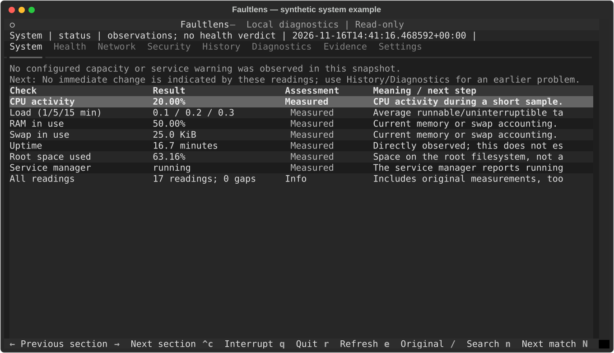
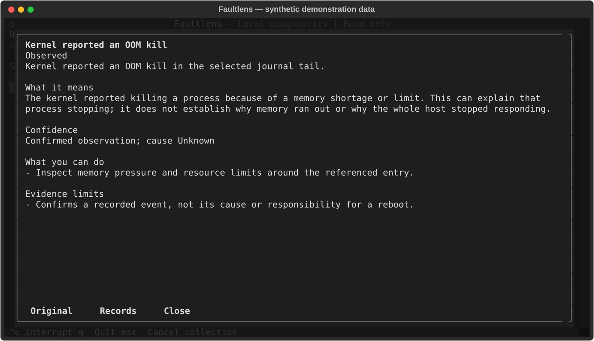

# UserDock-style terminal workspace

Faultlens uses the same interaction structure as the locally reviewed UserDock
reference: Textual Header, status line, horizontal TabbedContent, row-cursor
DataTables, modal screens and Footer. The old curses renderer is removed. The
primary workspace is domain tables, not a JSON/object menu. CLI collectors and
structured output remain independent of Textual.

## Install and launch

Use a trusted checkout as its owner:

```sh
python3 -m venv .venv
.venv/bin/python -m pip install --require-hashes --only-binary=:all: -r requirements-tui.txt
.venv/bin/python bin/faultlens tui
```

After activating `.venv`, `./bin/faultlens` also opens the workspace when attached
to an interactive terminal. Explicit CLI commands work with system Python without
these optional packages. No dependency downloads or installation occur at launch.
The reviewed Textual version and complete pure-Python wheel closure are pinned in
requirements-tui.txt; do not mix UserDock's environment with this project's.

Faultlens does not need root to launch. Source access depends on existing account
permissions. No elevation, account/group changes or host configuration writes occur.

## Navigation

| Key | Action |
| --- | --- |
| Left / Right | Previous / next main section, wrapping at either end |
| Up / Down, PageUp / PageDown, Home / End | Move through table rows |
| Enter | Open the selected record, finding, source or setting |
| Esc | Close the current dialog; at the workspace, cancel active collection |
| e | Open unchanged original evidence for the selected row/source |
| s | Explain the current snapshot or source coverage |
| r | Explicitly collect the current source section |
| /, n, N | Literal table search; next / previous match without filtering rows |
| Ctrl-Left / Ctrl-Right | Previous / next batch in a source-record dialog |
| q | Quit; in the raw evidence browser, close that browser |
| Ctrl-C | Cancel collection and quit with 130, restoring the terminal |
| ? | Keyboard, collection and confidence help |

Within an input dialog, arrow keys edit the input instead of switching sections.
Enter applies validated session options; Esc cancels. Boolean collection options
toggle through their table row. Changes affect later collection only.

System status loads on startup. Other sections require r; switching tabs alone
never requests historical data or optional sources. Collection runs in a bounded,
cancellable child process so tabs and cancellation remain responsive. A cancelled
refresh retains no replacement report. Native readers retain their own access and
resource constraints; kernel-uninterruptible I/O remains an operating-system limit.

## Sections and evidence

| Section | Main table / action |
| --- | --- |
| System | Current measurements, values and source states; Enter explains each reading |
| Health | Tool/service/recording readiness observations; missing data is not host failure |
| Network | Interface rates and protocol counters; explicitly requested sockets open a separate endpoint table |
| Security | Current indicators, or retained diagnosis findings when no current-security snapshot exists; the status line names the actual report |
| History | Visible boots, examined/unexamined status, report counts and retained-record counts; Select boot pins its ID without collecting |
| Diagnostics | Grouped reports and separate journal/security/recording/crash sources; open groups to inspect individual reports |
| Evidence | Explicit access to complete original report/source trees |
| Settings | Typed session-only collection options; no server configuration editor |

Repeated reports are grouped in the overview rather than called separate incidents.
Source dialogs render at most 64 rows per batch, show the retained total and retain
all records; Next/Previous or Ctrl-Right/Left reach the other batches. Pagination is
a rendering bound, not source truncation or redaction. Details explain observation,
meaning, confidence and next steps. Original and Records open retained evidence.
Raw trees are secondary inspection tools, never the main navigation model.

The workspace retains at most one bounded snapshot per six source sections. Replacing
a section drops its prior report first; Evidence shares references and Security may
share the diagnosis reference. Timestamps, actual report command and changed-option
notices distinguish stale or differently scoped results. No data is persisted.

## Safety and acceptance

Source strings are literal Rich Text with reversible ASCII/JSON escaping, never
markup, links, shell syntax or terminal sequences. Names, IPs, ports, original logs,
process identities and crash content are retained without privacy masking. Base64
represents original bytes; browsing does not decode them to files. Textual developer
endpoints, alternate drivers and log destinations are disabled. Fatal UI errors do
not render source exception text or locals.

Tests drive the real Textual app through Pilot, plus a real PTY for normal quit,
Ctrl-C and terminal restoration. Layout/navigation are checked at 100x30, 80x24 and
40x10, including resize and input focus. Synthetic screenshot previews contain no
host evidence. Actual server/SSH-client acceptance remains necessary; see
[server checks](server-check.md), [stabilization and product fit](stabilization.md)
and [frontend acceptance](architecture/phase-4-acceptance.md).

## Synthetic interface previews

These captures render the actual frontend using invented test data, never host logs.





Timeline details also retain a separate original position (`p` / Position), so the
finding and its timeline reference can both be inspected without guessing identity.
